# Depth Region VLM Experiment

This experiment answers one question: can depth information help a vision-language model (VLM) when the model merges image tokens?

An interactive version of this page is in `docs/explainer.html`. Open the file in a web browser.


## How token merge works

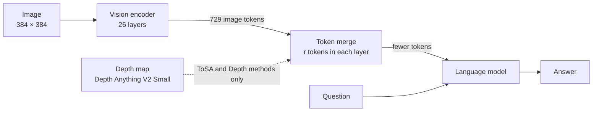

- The vision encoder makes 729 tokens from one image.
- In each layer, the merge step joins similar tokens. Thus, fewer tokens go to the language model.
- Fewer tokens make the model faster. But the answer can become less accurate.
- We compare five methods. Each method selects the tokens to merge in a different way.

| Method | Tokens that the method merges |
|---|---|
| No token merge | No tokens. This is the reference. |
| ToMe | Tokens with similar features. This is the official ToMe. |
| ToSA | Tokens with similar features, depth and position. The depth weight increases in each layer. This is the official ToSA. |
| Depth-only | Tokens in the same depth region with near depth and position. The method keeps the edge tokens. |
| Depth-RGB | The same rules as Depth-only. The method also uses feature similarity (weight 0.5). |

- All methods give the RGB image to the language model. The name "Depth-only" tells only how the method selects tokens.
- All methods use the same merge code from the official ToSA code. Each layer merges `r = int((384·384/14²)·(1 − keep)/27)` tokens.
- The model does not restore the merged tokens.

## Result

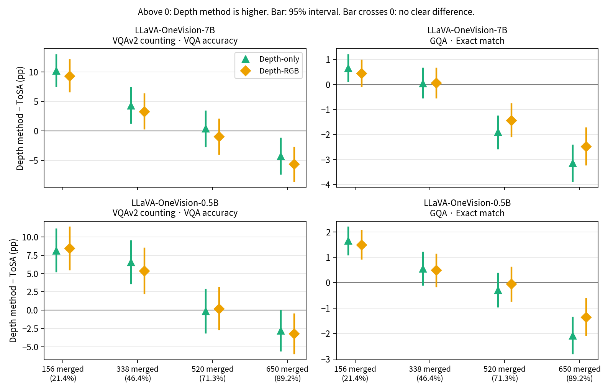

We compare two methods on the same questions. A paired bootstrap gives a 95% interval for the difference.

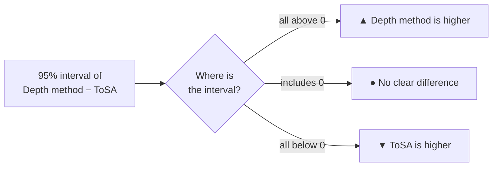

| Model · benchmark | 156 merged (21.4%) | 338 merged (46.4%) | 520 merged (71.3%) | 650 merged (89.2%) |
|---|---|---|---|---|
| 7B · VQAv2 counting | ▲ Depth higher | ▲ Depth higher | ● No clear difference | ▼ ToSA higher |
| 7B · GQA | ▲ Depth-only higher ¹ | ● No clear difference | ▼ ToSA higher | ▼ ToSA higher |
| 0.5B · VQAv2 counting | ▲ Depth higher | ▲ Depth higher | ● No clear difference | ▼ ToSA higher ² |
| 0.5B · GQA | ▲ Depth higher | ● No clear difference | ● No clear difference | ▼ ToSA higher |

¹ Depth-RGB: no clear difference (+0.44 pp, interval −0.07 to +0.96).
² This result is weak. The Depth-only interval ends at −0.09 pp. The ToSA score changes by approximately 1 pp between runs.

pp = percentage points.

- **Few merged tokens:** the Depth methods are better than ToSA. On VQAv2 counting at 156 merged tokens, the gain is +8 to +10 pp.
- **Many merged tokens:** ToSA is better. At 650 merged tokens, ToSA is higher in all 8 comparisons (−1.4 to −5.6 pp for the Depth methods).
- **ToSA and ToMe:** on VQAv2 counting, ToSA is higher at most merge levels (+4 to +8 pp). On GQA, the difference is small or not clear.
- All methods completed all questions.

## Speed and compute

The full report is in `docs/latency_and_compute.md`.

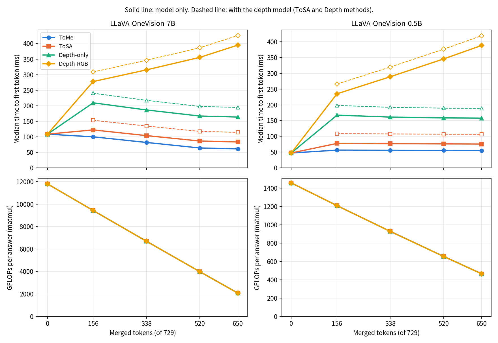

| Item | 7B | 0.5B |
|---|---|---|
| FLOPs | Same for all four methods. 650 merged: 18% of No token merge. | Same for all four methods. 650 merged: 32% of No token merge. |
| Fastest method | ToMe: 1.78 times faster than No token merge at 650 merged | No method is faster than No token merge |
| ToSA, with the depth model | 0.71 to 0.95 times: slower than No token merge | 0.43 to 0.44 times |
| Depth methods − ToSA | Depth-only +80 to +88 ms. Depth-RGB +156 to +312 ms. | Depth-only +82 to +90 ms. Depth-RGB +158 to +313 ms. |

- The time is time to first token on one A100, batch size 1, median of 600 answers.
- The Depth methods are slow because of region and merge-plan work in the research code. This work is not in the FLOPs.

## Test setup

| Item | Value |
|---|---|
| Models | LLaVA-OneVision-7B and LLaVA-OneVision-0.5B, with the run path of the official ToSA code. One 384 × 384 image gives 729 tokens. |
| Benchmarks | VQAv2 counting: 1,000 questions. GQA testdev-balanced: all 12,578 questions. |
| Merge levels | 156, 338, 520 or 650 of 729 tokens (21.4%, 46.4%, 71.3%, 89.2%) |
| Scores | VQAv2 counting: VQA accuracy (main score) and RCA (the score of the ToSA paper). GQA: exact match. |
| Decoding | Greedy decoding. The prompt is the prompt of the official `run_vqa_3d_tome.py`. |
| Rule | We wrote all conditions in a protocol file before the test. We did not change them after we saw the results. |

- Protocol files: `experiments/2026-10-28_7b_vqav2_gqa/protocol.json`, `experiments/2026-10-28_0.5b_vqav2_gqa/protocol.json`, `experiments/2026-10-28_depth_relaxed/protocol.json`
- Code repository: `ondeviceteam/depth-region-vlm`, commit `efe0a51`

### Scores

- **VQA accuracy:** the official VQAv2 score. It compares the answer with 10 human answers. All 1,000 questions count.
- **RCA:** 911 questions have a correct count of 1 or more. For these questions, RCA is the mean of `1 − |prediction − answer| / answer`. It shows how near the count is.
- **Exact match:** the answer is correct when its first sentence is the same as the correct answer. Before the comparison, we change the text to lower case and remove punctuation and articles. We also change number words to digits.

### Questions

- **VQAv2 counting (`datasets/vqav2_count1000.json`):** "how many" questions from VQAv2 val with a correct answer of 0 or more. One question for each image, 1,000 questions, seed 20261028. 89 questions have the answer 0. 911 questions have an answer of 1 or more. We removed 250 images that an earlier experiment used (`datasets/excluded_coco_val2014_images.json`).
- **GQA (`datasets/gqa_testdev_balanced.json`):** all 12,578 questions of testdev-balanced, 398 images.

## Scores: LLaVA-OneVision-7B

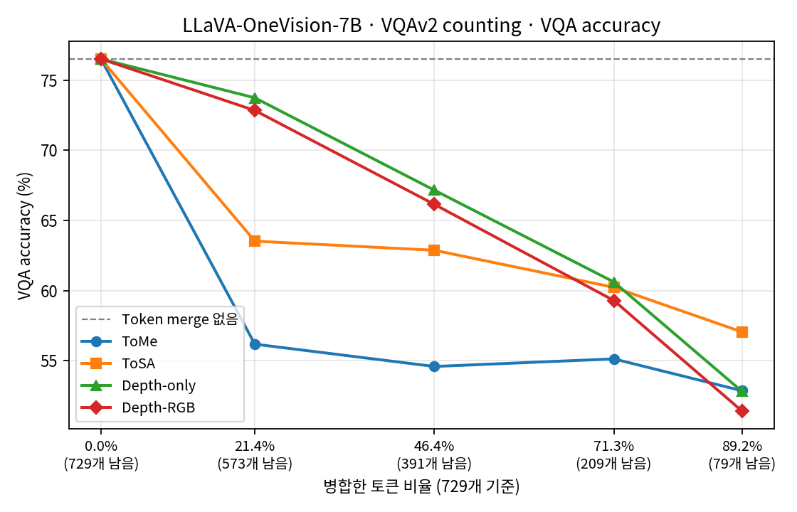

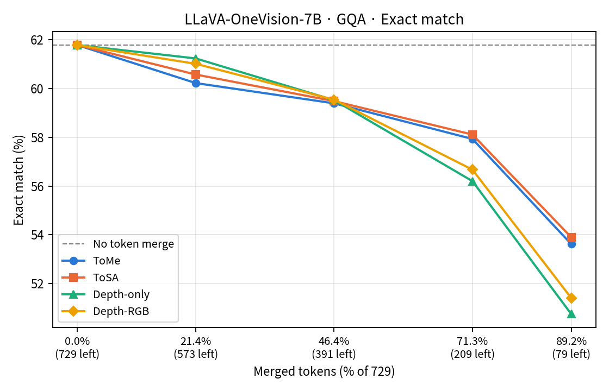

More figures are in `figures/7b/`.

<details>
<summary><b>Score tables (7B)</b></summary>

- A bold value is the highest value of the merge methods.
- *No token merge* is the reference. All tables show the same value for it.
- "Completed" is the number of questions that the method merged to the target token count.
- For conditions with 3 runs, the tables show the first run.

#### VQAv2 counting · 156 tokens merged (21.4% of 729, 573 tokens left)

| Method | VQA accuracy (%) | RCA (%) | Completed |
|---|---:|---:|---:|
| *No token merge* | *76.50* | *79.51* | 1000/1000 |
| ToMe | 56.18 | 61.22 | 1000/1000 |
| ToSA | 63.52 | 68.55 | 1000/1000 |
| Depth-only | **73.73** | **77.97** | 1000/1000 |
| Depth-RGB | 72.83 | 76.61 | 1000/1000 |

#### VQAv2 counting · 338 tokens merged (46.4% of 729, 391 tokens left)

| Method | VQA accuracy (%) | RCA (%) | Completed |
|---|---:|---:|---:|
| *No token merge* | *76.50* | *79.51* | 1000/1000 |
| ToMe | 54.59 | 58.63 | 1000/1000 |
| ToSA | 62.87 | 67.69 | 1000/1000 |
| Depth-only | **67.15** | 71.61 | 1000/1000 |
| Depth-RGB | 66.14 | **73.48** | 1000/1000 |

#### VQAv2 counting · 520 tokens merged (71.3% of 729, 209 tokens left)

| Method | VQA accuracy (%) | RCA (%) | Completed |
|---|---:|---:|---:|
| *No token merge* | *76.50* | *79.51* | 1000/1000 |
| ToMe | 55.13 | 59.71 | 1000/1000 |
| ToSA | 60.23 | 64.80 | 1000/1000 |
| Depth-only | **60.61** | **65.42** | 1000/1000 |
| Depth-RGB | 59.29 | 65.40 | 1000/1000 |

#### VQAv2 counting · 650 tokens merged (89.2% of 729, 79 tokens left)

| Method | VQA accuracy (%) | RCA (%) | Completed |
|---|---:|---:|---:|
| *No token merge* | *76.50* | *79.51* | 1000/1000 |
| ToMe | 52.86 | 59.53 | 1000/1000 |
| ToSA | **57.05** | **63.44** | 1000/1000 |
| Depth-only | 52.81 | 58.61 | 1000/1000 |
| Depth-RGB | 51.41 | 57.93 | 1000/1000 |

#### GQA · 156 tokens merged (21.4% of 729, 573 tokens left)

| Method | Exact match (%) | Completed |
|---|---:|---:|
| *No token merge* | *61.78* | 12578/12578 |
| ToMe | 60.22 | 12578/12578 |
| ToSA | 60.57 | 12578/12578 |
| Depth-only | **61.23** | 12578/12578 |
| Depth-RGB | 61.01 | 12578/12578 |

#### GQA · 338 tokens merged (46.4% of 729, 391 tokens left)

| Method | Exact match (%) | Completed |
|---|---:|---:|
| *No token merge* | *61.78* | 12578/12578 |
| ToMe | 59.39 | 12578/12578 |
| ToSA | 59.48 | 12578/12578 |
| Depth-only | 59.52 | 12578/12578 |
| Depth-RGB | **59.54** | 12578/12578 |

#### GQA · 520 tokens merged (71.3% of 729, 209 tokens left)

| Method | Exact match (%) | Completed |
|---|---:|---:|
| *No token merge* | *61.78* | 12578/12578 |
| ToMe | 57.93 | 12578/12578 |
| ToSA | **58.11** | 12578/12578 |
| Depth-only | 56.20 | 12578/12578 |
| Depth-RGB | 56.67 | 12578/12578 |

#### GQA · 650 tokens merged (89.2% of 729, 79 tokens left)

| Method | Exact match (%) | Completed |
|---|---:|---:|
| *No token merge* | *61.78* | 12578/12578 |
| ToMe | 53.62 | 12578/12578 |
| ToSA | **53.90** | 12578/12578 |
| Depth-only | 50.75 | 12578/12578 |
| Depth-RGB | 51.41 | 12578/12578 |

</details>

<details>
<summary><b>Repeat runs (7B)</b></summary>

We did 3 runs of VQAv2 counting at 338 merged tokens.

| Method | VQA accuracy, 3 runs (%) | Questions with the same answer in all 3 runs |
|---|---|---:|
| No token merge | 76.50 / 76.50 / 76.50 | 100.0% |
| ToMe | 54.59 / 55.58 / 54.16 | 81.7% |
| ToSA | 62.87 / 62.39 / 62.75 | 85.2% |

- ToMe and ToSA give different answers in different runs, with the same input and the same seed. We did not find the cause.
- The score range of the 3 runs is 1.42 pp for ToMe and 0.48 pp for ToSA.
- At 338 merged tokens, the difference between the Depth methods and ToSA is 3 to 4 pp. This is larger than the range.
- The Depth methods always give the same answer for the same input. Thus, we did not repeat them.

</details>

## Scores: LLaVA-OneVision-0.5B

The questions, methods, merge levels and scores are the same as for 7B. Only the model is different.

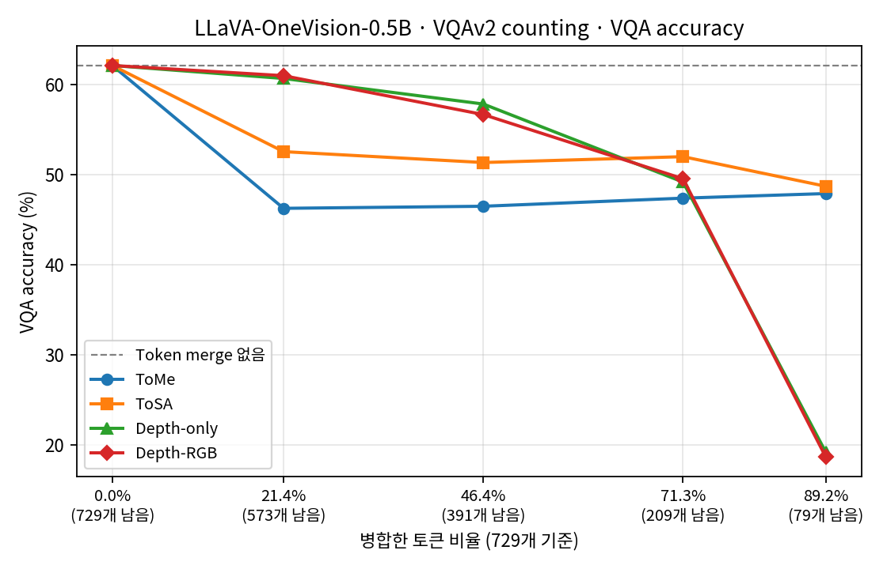

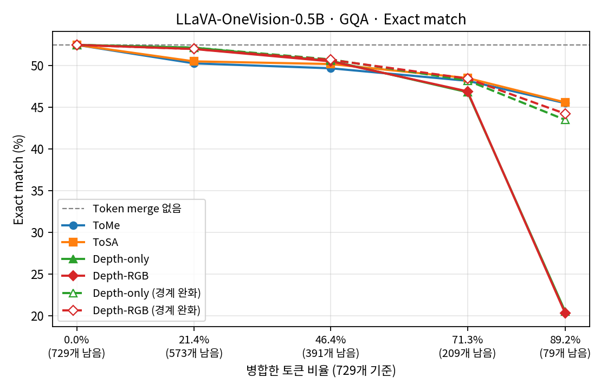

More figures are in `figures/0.5b/`.

<details>
<summary><b>Score tables (0.5B)</b></summary>

#### VQAv2 counting · 156 tokens merged (21.4% of 729, 573 tokens left)

| Method | VQA accuracy (%) | RCA (%) | Completed |
|---|---:|---:|---:|
| *No token merge* | *62.13* | *69.67* | 1000/1000 |
| ToMe | 46.26 | 47.93 | 1000/1000 |
| ToSA | 52.56 | 55.50 | 1000/1000 |
| Depth-only | 60.69 | 68.17 | 1000/1000 |
| Depth-RGB | **61.00** | **68.62** | 1000/1000 |

#### VQAv2 counting · 338 tokens merged (46.4% of 729, 391 tokens left)

| Method | VQA accuracy (%) | RCA (%) | Completed |
|---|---:|---:|---:|
| *No token merge* | *62.13* | *69.67* | 1000/1000 |
| ToMe | 46.49 | 48.95 | 1000/1000 |
| ToSA | 51.35 | 55.44 | 1000/1000 |
| Depth-only | **57.88** | **64.21** | 1000/1000 |
| Depth-RGB | 56.71 | 62.17 | 1000/1000 |

#### VQAv2 counting · 520 tokens merged (71.3% of 729, 209 tokens left)

| Method | VQA accuracy (%) | RCA (%) | Completed |
|---|---:|---:|---:|
| *No token merge* | *62.13* | *69.67* | 1000/1000 |
| ToMe | 47.39 | 53.44 | 1000/1000 |
| ToSA | 52.00 | 57.40 | 1000/1000 |
| Depth-only | 51.85 | 57.47 | 1000/1000 |
| Depth-RGB | **52.18** | **60.29** | 1000/1000 |

#### VQAv2 counting · 650 tokens merged (89.2% of 729, 79 tokens left)

| Method | VQA accuracy (%) | RCA (%) | Completed |
|---|---:|---:|---:|
| *No token merge* | *62.13* | *69.67* | 1000/1000 |
| ToMe | 47.90 | **60.23** | 1000/1000 |
| ToSA | **48.71** | 59.60 | 1000/1000 |
| Depth-only | 45.91 | 55.54 | 1000/1000 |
| Depth-RGB | 45.47 | 55.43 | 1000/1000 |

#### GQA · 156 tokens merged (21.4% of 729, 573 tokens left)

| Method | Exact match (%) | Completed |
|---|---:|---:|
| *No token merge* | *52.46* | 12578/12578 |
| ToMe | 50.25 | 12578/12578 |
| ToSA | 50.49 | 12578/12578 |
| Depth-only | **52.13** | 12578/12578 |
| Depth-RGB | 51.97 | 12578/12578 |

#### GQA · 338 tokens merged (46.4% of 729, 391 tokens left)

| Method | Exact match (%) | Completed |
|---|---:|---:|
| *No token merge* | *52.46* | 12578/12578 |
| ToMe | 49.66 | 12578/12578 |
| ToSA | 50.17 | 12578/12578 |
| Depth-only | **50.72** | 12578/12578 |
| Depth-RGB | 50.67 | 12578/12578 |

#### GQA · 520 tokens merged (71.3% of 729, 209 tokens left)

| Method | Exact match (%) | Completed |
|---|---:|---:|
| *No token merge* | *52.46* | 12578/12578 |
| ToMe | 48.16 | 12578/12578 |
| ToSA | **48.49** | 12578/12578 |
| Depth-only | 48.20 | 12578/12578 |
| Depth-RGB | 48.43 | 12578/12578 |

#### GQA · 650 tokens merged (89.2% of 729, 79 tokens left)

| Method | Exact match (%) | Completed |
|---|---:|---:|
| *No token merge* | *52.46* | 12578/12578 |
| ToMe | 45.49 | 12578/12578 |
| ToSA | **45.58** | 12578/12578 |
| Depth-only | 43.49 | 12578/12578 |
| Depth-RGB | 44.22 | 12578/12578 |

</details>

<details>
<summary><b>Repeat runs (0.5B)</b></summary>

| Method | VQA accuracy, 3 runs (%) | Questions with the same answer in all 3 runs |
|---|---|---:|
| No token merge | 62.13 / 62.13 / 62.13 | 100.0% |
| ToMe | 46.49 / 46.58 / 46.43 | 75.8% |
| ToSA | 51.35 / 51.45 / 50.35 | 76.6% |

- The score range of the 3 runs is 0.15 pp for ToMe and 1.10 pp for ToSA.
- At 338 merged tokens, the difference between the Depth methods and ToSA is 5 to 7 pp. This is larger than the range.

</details>

## How the Depth methods set the edge threshold

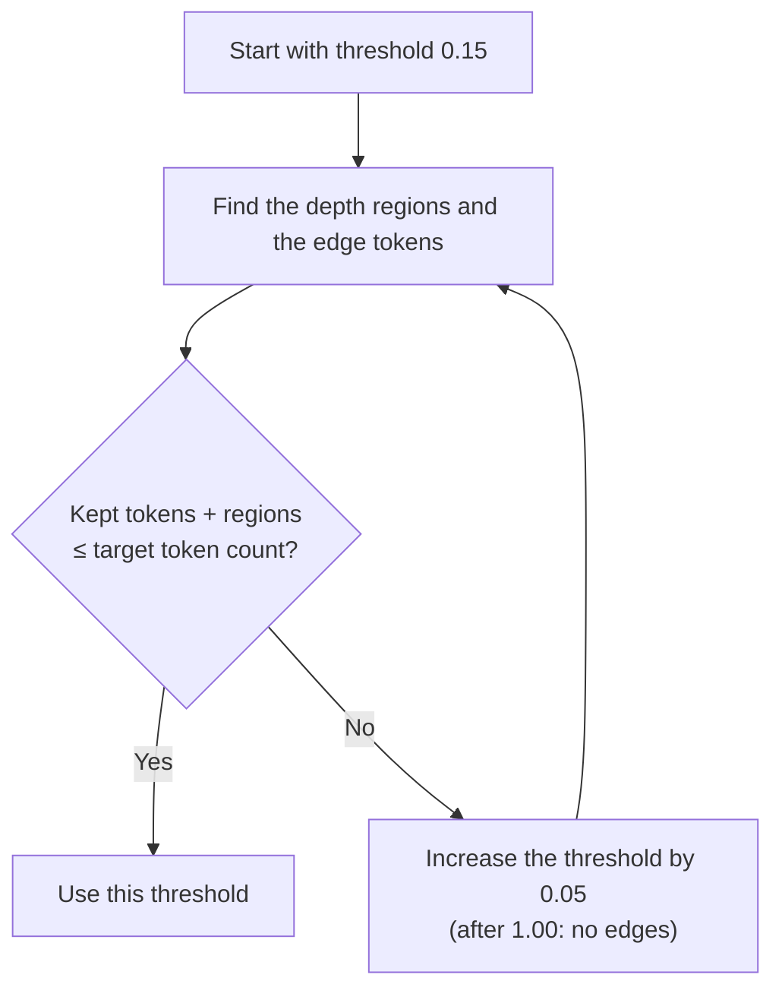

- A depth change larger than the threshold makes an edge. The Depth methods keep the edge tokens and one token for each region.
- If the kept tokens and regions are more than the target, the method cannot merge to the target. Thus, the method increases the threshold for that image.
- Most images use 0.15. The highest threshold is 0.55 for VQAv2 counting and 0.50 for GQA. No image needed "no edges".
- We calculated all thresholds from the depth maps before the test (`datasets/relaxed_boundary_thresholds.json`). The thresholds do not depend on the model.
- We made this rule after the previous experiment. In that experiment, many questions failed at high merge levels. We wrote the rule in the protocol before the test.

| Merged tokens | Questions above 0.15: VQAv2 counting (of 1,000) | GQA (of 12,578) |
|---|---:|---:|
| 156 | 0 | 0 |
| 338 | 1 | 49 |
| 520 | 50 | 457 |
| 650 | 550 | 6,837 |

Checks:

- In all 217,248 answers, the number of tokens after the merge was the same as the target.
- In all answers, the threshold was the same as the threshold in the file.
- For questions with threshold 0.15, all answers were the same as in the previous experiment.

## ToSA merge amount and quantization

**Question:** when ToSA merges more tokens, does quantization lose more accuracy?

**Result:** we did not find this effect. The full report is in `docs/quantization_interaction.md`.

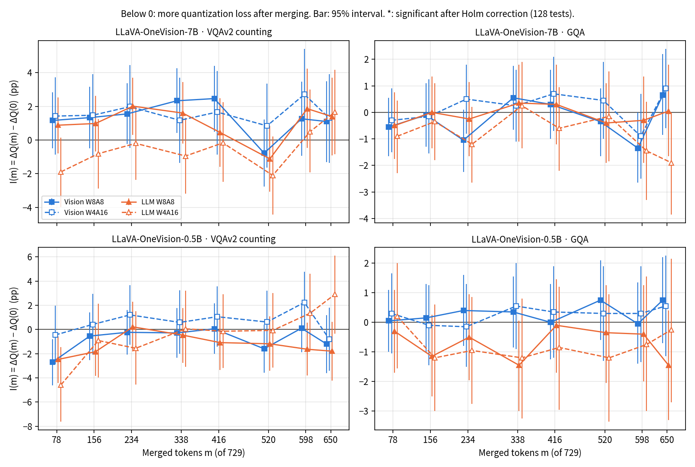

| Test | Result |
|---|---|
| I(m) at all 8 merge levels (128 tests, Holm correction) | 0 tests show a clear larger loss |
| Trend of the loss as merge increases (16 tests) | No falling trend. One rising trend (0.5B, VQAv2 counting, LLM W4A16): the loss becomes smaller with more merge. |
| Overall test of all levels (Hotelling T², 16 tests) | 0 series show a clear change |
| 0.5B, VQAv2 counting, LLM W4A16, 78 merged (10.7%), 3 runs | I = −4.32 pp (interval −7.28 to −1.32). It repeats in all 3 runs. It does not pass the correction (corrected p = 0.15). Possible effect at one level, not confirmed. |

The first analysis below tested only 338 and 650 merged tokens. 31 of its 32 tests show no clear difference. The last test (7B, vision W8A8, VQAv2 counting, 338 merged) goes in the opposite direction. Its value also changes between runs.

<p>
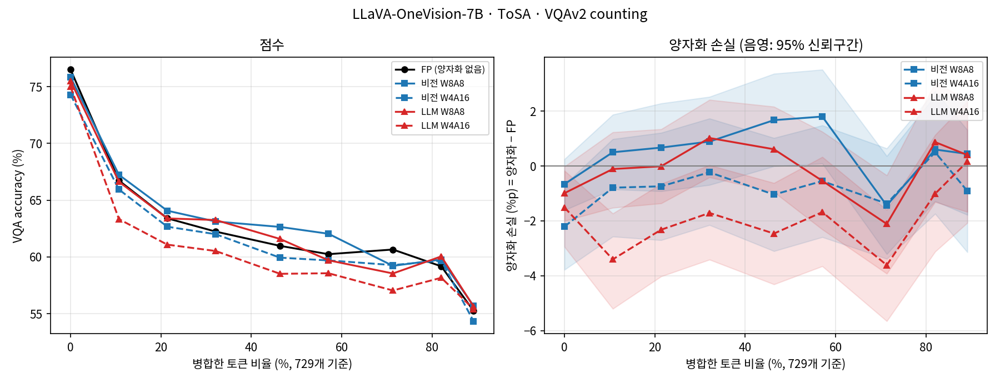
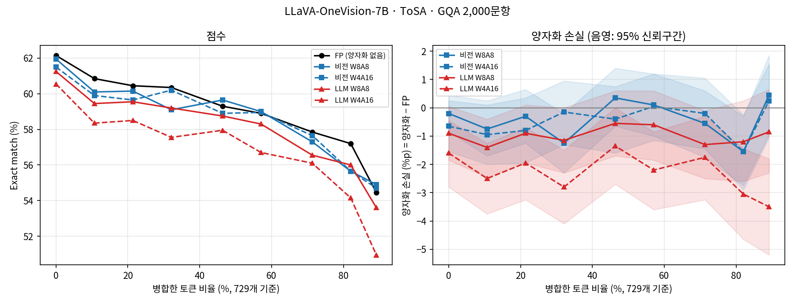
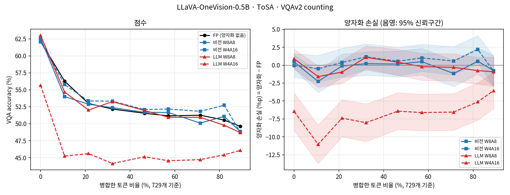
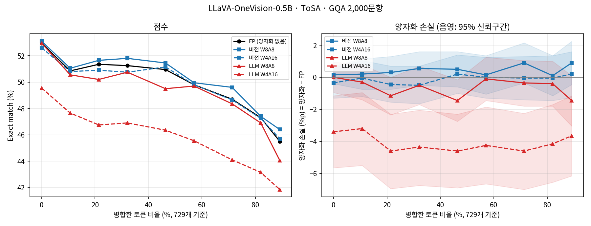
</p>

- 0.5B with LLM W4A16 loses accuracy at all merge levels. On VQAv2 counting, the loss is 6.46 pp with no merge (interval −9.12 to −3.89). The loss is 6.41 pp at 338 merged (interval −8.97 to −3.84).
- 7B with LLM W4A16 loses 1.90 pp more on GQA at 650 merged. But the interval (−3.85 to +0.00) touches 0. Thus, there is no clear difference.
- The first analysis did not correct for multiple tests. The all-level analysis above uses the Holm correction.

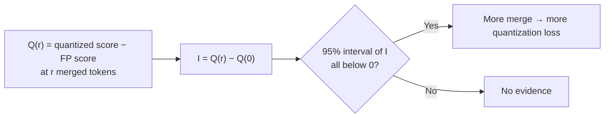

| Item | Value |
|---|---|
| Models | LLaVA-OneVision-7B and LLaVA-OneVision-0.5B, the same run path as above |
| Method | ToSA only |
| Merge amount | `r` = 0, 3, 6, 9, 13, 16, 20, 23, 25 in each layer: 0 to 650 of 729 tokens (9 levels) |
| Precision | FP (FP16/BF16, as above). Vision encoder only: W8A8 or W4A16. LLM only: W8A8 or W4A16. |
| Benchmarks | VQAv2 counting: the same 1,000 questions. GQA testdev-balanced: 2,000 questions (`datasets/gqa_testdev_balanced_2000.json`, seed 20261028). |
| Primary test | I at 338 and 650 merged tokens. Paired bootstrap on the same questions, 10,000 times, 95% interval. |

- **W8A8:** 8-bit weights for each output channel. 8-bit dynamic activations for each token.
- **W4A16:** 4-bit weights only, in groups of 128 input channels.
- The quantization is simulated (fake quantization). The values are rounded and kept in the original data type. Thus, speed and memory do not change.
- Quantized layers: 156 Linear layers in the 26 vision encoder layers, or the Linear layers of the LLM decoder (168 for 0.5B, 196 for 7B). We did not quantize the projector, lm_head and normalization layers. We used no calibration data.
- The protocol file is `experiments/2026-10-28_tosa_quantization/protocol.json`.

<details>
<summary><b>Score tables (quantization)</b></summary>


#### 7B · VQAv2 counting (1,000 questions) · VQA accuracy (%)

| Precision \ merged tokens | 0 | 78 | 156 | 234 | 338 | 416 | 520 | 598 | 650 |
|---|---:|---:|---:|---:|---:|---:|---:|---:|---:|
| FP (no quantization) | 76.50 | 66.73 | 63.40 | 62.23 | 60.97 | 60.24 | 60.65 | 59.17 | 55.25 |
| Vision W8A8 | 75.84 | 67.23 | 64.07 | 63.12 | 62.64 | 62.04 | 59.21 | 59.77 | 55.69 |
| Vision W4A16 | 74.29 | 65.94 | 62.66 | 62.00 | 59.93 | 59.69 | 59.28 | 59.67 | 54.34 |
| LLM W8A8 | 75.51 | 66.62 | 63.39 | 63.25 | 61.58 | 59.70 | 58.54 | 60.04 | 55.65 |
| LLM W4A16 | 74.99 | 63.33 | 61.08 | 60.52 | 58.51 | 58.56 | 57.04 | 58.16 | 55.41 |

#### 7B · GQA (2,000 questions) · Exact match (%)

| Precision \ merged tokens | 0 | 78 | 156 | 234 | 338 | 416 | 520 | 598 | 650 |
|---|---:|---:|---:|---:|---:|---:|---:|---:|---:|
| FP (no quantization) | 62.15 | 60.85 | 60.45 | 60.35 | 59.30 | 58.90 | 57.85 | 57.20 | 54.45 |
| Vision W8A8 | 61.95 | 60.10 | 60.15 | 59.10 | 59.65 | 59.00 | 57.30 | 55.65 | 54.90 |
| Vision W4A16 | 61.50 | 59.90 | 59.65 | 60.20 | 58.90 | 58.95 | 57.65 | 55.65 | 54.70 |
| LLM W8A8 | 61.25 | 59.45 | 59.55 | 59.20 | 58.75 | 58.30 | 56.55 | 56.00 | 53.60 |
| LLM W4A16 | 60.55 | 58.35 | 58.50 | 57.55 | 57.95 | 56.70 | 56.10 | 54.15 | 50.95 |

#### 0.5B · VQAv2 counting (1,000 questions) · VQA accuracy (%)

| Precision \ merged tokens | 0 | 78 | 156 | 234 | 338 | 416 | 520 | 598 | 650 |
|---|---:|---:|---:|---:|---:|---:|---:|---:|---:|
| FP (no quantization) | 62.13 | 56.28 | 52.99 | 52.17 | 51.55 | 51.17 | 51.26 | 50.55 | 49.63 |
| Vision W8A8 | 62.57 | 54.01 | 52.88 | 52.37 | 51.70 | 51.66 | 50.10 | 51.09 | 48.87 |
| Vision W4A16 | 62.09 | 55.78 | 53.36 | 53.33 | 52.09 | 52.18 | 51.83 | 52.74 | 48.78 |
| LLM W8A8 | 63.01 | 54.68 | 52.03 | 53.26 | 51.96 | 50.96 | 50.95 | 49.79 | 48.71 |
| LLM W4A16 | 55.67 | 45.24 | 45.61 | 44.15 | 45.14 | 44.56 | 44.72 | 45.43 | 46.08 |

#### 0.5B · GQA (2,000 questions) · Exact match (%)

| Precision \ merged tokens | 0 | 78 | 156 | 234 | 338 | 416 | 520 | 598 | 650 |
|---|---:|---:|---:|---:|---:|---:|---:|---:|---:|
| FP (no quantization) | 52.95 | 50.85 | 51.35 | 51.25 | 50.95 | 49.80 | 48.70 | 47.30 | 45.50 |
| Vision W8A8 | 53.10 | 51.05 | 51.65 | 51.80 | 51.45 | 49.95 | 49.60 | 47.40 | 46.40 |
| Vision W4A16 | 52.60 | 50.80 | 50.90 | 50.75 | 51.15 | 49.80 | 48.65 | 47.25 | 45.70 |
| LLM W8A8 | 52.95 | 50.55 | 50.20 | 50.75 | 49.50 | 49.70 | 48.35 | 46.90 | 44.05 |
| LLM W4A16 | 49.55 | 47.65 | 46.75 | 46.90 | 46.35 | 45.55 | 44.10 | 43.15 | 41.85 |

- The FP rows use the same settings as ToSA above. But ToSA gives different answers in different runs. Thus, the values are a little different.
- GQA uses 2,000 questions here. Thus, the GQA values are different from the 12,578-question values above.

</details>

<details>
<summary><b>Repeat runs (quantization)</b></summary>

We did 3 runs of VQAv2 counting at 338 merged tokens for all precisions. The primary test uses the first run.

| Model | Precision | VQA accuracy, 3 runs (%) | Questions with the same answer in all 3 runs |
|---|---|---|---:|
| 7B | FP | 60.97 / 62.49 / 62.58 | 87.5% |
| 7B | Vision W8A8 | 62.64 / 61.94 / 61.45 | 85.6% |
| 7B | Vision W4A16 | 59.93 / 59.81 / 59.86 | 85.6% |
| 7B | LLM W8A8 | 61.58 / 62.25 / 61.57 | 77.1% |
| 7B | LLM W4A16 | 58.51 / 58.78 / 59.58 | 84.8% |
| 0.5B | FP | 51.55 / 51.58 / 51.25 | 84.8% |
| 0.5B | Vision W8A8 | 51.70 / 51.43 / 51.39 | 84.1% |
| 0.5B | Vision W4A16 | 52.09 / 52.14 / 51.82 | 83.7% |
| 0.5B | LLM W8A8 | 51.96 / 51.94 / 52.39 | 76.7% |
| 0.5B | LLM W4A16 | 45.14 / 45.27 / 44.90 | 77.4% |

- The first FP run of 7B (60.97) is lower than the other two runs (62.49, 62.58).
- We calculated I again for 7B vision W8A8 at 338 merged, with runs of the same number (an added analysis). The values are +2.33, +0.11 and −0.47 pp.
- Thus, the one significant result comes from the change in the first FP run.

</details>

## Previous experiments

This page does not show numbers from these experiments.

| Experiment | Status |
|---|---|
| Depth-only and Depth-RGB with a fixed edge threshold of 0.15 (Depth rows in `results/2026-10-28_{7b,0.5b}_vqav2_gqa`) | Replaced. At high merge levels, many questions could not merge to the target and got 0 points. The current methods set the threshold for each image. The raw answers stay in the result folders. |
| No token merge, ToMe and ToSA from the same runs (`results/2026-10-28_{7b,0.5b}_vqav2_gqa`) | Used again. The tables above use these answers. The questions and models are the same as for the current Depth methods. |

## Files and reproduction

| Path | Contents |
|---|---|
| `docs/explainer.html` | Interactive explanation of this experiment (open in a web browser) |
| `docs/diagrams/` | Diagrams of this README |
| `experiments/2026-10-28_{7b,0.5b}_vqav2_gqa/` | Protocol of the No token merge, ToMe and ToSA runs, and the compatibility patch for the official ToSA code |
| `results/2026-10-28_{7b,0.5b}_vqav2_gqa/` | Raw answers (jsonl), environment, logs and score CSV files of No token merge, ToMe and ToSA. The Depth rows in these files are from the previous experiment. |
| `experiments/2026-10-28_depth_relaxed/`, `results/2026-10-28_depth_relaxed/` | Protocol, raw answers and scores of Depth-only and Depth-RGB: `summary.csv` (scores), `paired_differences.csv` (difference from ToSA and ToMe with 95% interval), `consistency.csv` (same answers as the previous experiment). The name part "relaxed" separates these files from the previous experiment. |
| `datasets/relaxed_boundary_thresholds.json` | Edge threshold for each image and merge level |
| `experiments/2026-10-28_tosa_quantization/`, `results/2026-10-28_tosa_quantization/` | Protocol, raw answers, scores (`scores.csv`), quantization loss (`quant_loss.csv`), primary tests (`interaction.csv`) and repeat runs of the quantization experiment |
| `docs/latency_and_compute.md` | Report of time, memory and FLOPs for each method and merge level |
| `experiments/2026-10-29_latency_compute/`, `results/2026-10-29_latency_compute/` | Protocol, raw time and FLOPs rows, and summary CSV files of the speed measurement |
| `docs/quantization_interaction.md` | Report of the quantization loss at all merge levels, the trend and the repeat runs |
| `experiments/2026-10-29_quant_interaction/`, `results/2026-10-29_quant_interaction/` | Protocol, answers of the repeat runs, and the test CSV files |
| `figures/` | Figures: `summary/` (difference from ToSA), `7b/` and `0.5b/` (score for each merge level), `quantization/`, `latency/` |
| `scripts/` | Code for data, depth maps, inference, scores and figures |

You can make all tables and figures again from the raw answers:

```bash
X=results/2026-10-28_depth_relaxed
for m in 7b 0.5b; do
  python scripts/summarize.py results/2026-10-28_${m}_vqav2_gqa   # scores and CSV files (bootstrap needs much memory)
done
python scripts/summarize_relaxed.py $X                             # Depth methods: scores, comparison, checks
for m in 7b 0.5b; do
  R=results/2026-10-28_${m}_vqav2_gqa
  python scripts/readme_tables.py $R $X                            # score tables of this README
  python scripts/plot_results.py $R figures/$m $X
done
python scripts/plot_difference.py $X figures/summary/difference_vs_tosa.png
python scripts/summarize_quant.py results/2026-10-28_tosa_quantization
python scripts/plot_quant.py results/2026-10-28_tosa_quantization figures/quantization
python scripts/summarize_latency.py results/2026-10-29_latency_compute figures/latency
python scripts/analyze_quant_interaction.py results/2026-10-28_tosa_quantization results/2026-10-29_quant_interaction figures/quantization
python -m pytest scripts/test_counting_rca.py
```

- No token merge, ToMe and ToSA: `scripts/launch_eval.sh JOB RUNTIME DATA EXPERIMENT OUTPUT dataset:variant:shard:num_shards:gpu ...` in a PBS job. `EXPERIMENT` is a folder name in `experiments/`. The protocol sets the model. The 7B runs used the script of commit `47e0f8b`, before this argument was added. The harness hash in the protocol is the same as that file.
- Depth methods: `scripts/launch_relaxed_eval.sh` (job format `model:dataset:shard:num_shards:gpu`). The thresholds come from `scripts/relax_thresholds.py`.
- Quantization: `scripts/launch_quant_eval.sh` (job format `model:precision:dataset:shard:num_shards:gpu`). Repeat runs: `scripts/launch_quant_replicate.sh` (same format).
- Speed: `scripts/launch_latency.sh JOB RUNTIME DATA EXPERIMENT OUTPUT GPU_INDEX`.
- Depth maps: `scripts/launch_depth.sh`.
