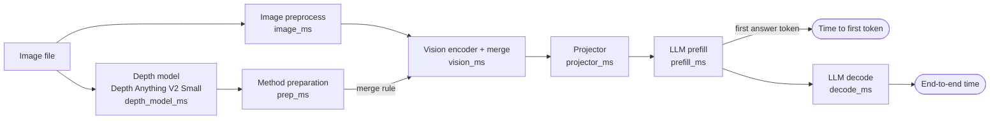
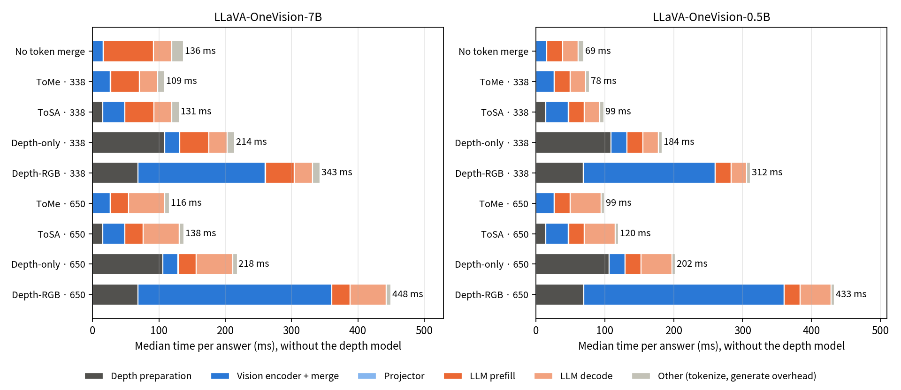
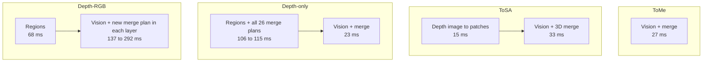

# Latency and Compute of the Token Merge Methods

This document gives the cost side of the score results in `README.md`.
It shows the time, the GPU memory and the matrix-multiplication work (FLOPs) for each method and each merge level.

## Result

| Question | Answer |
|---|---|
| Do the four merge methods do the same FLOPs? | Yes. The FLOPs are the same within 0.3% at each merge level. Only the number of tokens sets the FLOPs. |
| Which method is fastest? | ToMe, at all merge levels and on the two models. |
| Does token merge make the 7B model faster? | Yes for ToMe (up to 1.78 times) and ToSA without the depth model (up to 1.30 times). ToSA with the depth model is not faster than No token merge. |
| Does token merge make the 0.5B model faster? | No. All methods are slower than No token merge. |
| Are the Depth methods slower than ToSA? | Yes, at all merge levels and on the two models. Depth-only adds 80 to 90 ms. Depth-RGB adds 156 to 313 ms. All 95% intervals are far from 0. |
| Why are the Depth methods slow? | Region and merge-plan work on the CPU and in small GPU steps. This work is not matrix multiplication, so the FLOPs do not show it. |

Read these results as results of the current research code. They are not the limit of each algorithm.
The section "Limits" gives the details.

## What we measure



| Name | Stages in the time | Use |
|---|---|---|
| Time to first token | prep + vision + projector + prefill + small overhead | Main speed number. It does not change with the answer length. |
| End-to-end time | time to first token + decode | Time for the full answer. It changes with the number of answer tokens. |
| With the depth model | the time above + 30.9 ms | ToSA, Depth-only and Depth-RGB need a depth map. ToMe and No token merge do not. |

- The time does not include `image_ms` (10.6 ms for all methods).
- The protocol gave end-to-end time as the main number. After the first look at the data, we added time to first token.
  The reason: heavy merge makes the answers a little longer (mean 2.2 tokens at No token merge, 2.7 to 3.2 tokens at 650 merged tokens).
  One more decode step adds 22 ms (0.5B) or 27 ms (7B). Thus end-to-end time mixes speed with answer length.
- FLOPs come from `torch.utils.flop_counter.FlopCounterMode`. It counts matrix multiplications only.

## Test setup

| Item | Value |
|---|---|
| Hardware | One NVIDIA A100-SXM4-80GB. One process on the GPU at a time. |
| Models | LLaVA-OneVision 0.5B and 7B, official ToSA code, eager attention, batch size 1 |
| Precision | Vision encoder FP16. LLM and projector BF16. |
| Questions | 100 VQAv2 counting + 100 GQA (the first 100 of each score set) |
| Repeats | 3 passes over the 200 questions. 5 warm-up questions before each model. |
| Time per cell | Median and 90th percentile of 600 answers |
| FLOPs per cell | Mean of 20 questions |
| Depth model | Depth Anything V2 Small, 126 images, 3 passes |
| Paired comparison | Depth method minus ToSA, same question. Median of the per-question difference. 95% bootstrap interval (10,000 samples). |

The protocol is in `experiments/2026-10-29_latency_compute/protocol.json`. We froze it before the measurement.

## Time and FLOPs against merge level


- Top row: time to first token. Solid line: model only. Dashed line: with the depth model.
- Bottom row: FLOPs. The four lines are on top of each other.

## Where the time goes





- **Depth-only** makes all 26 merge plans before the vision encoder starts. It uses only the depth map. Thus its preparation is long, but its vision stage is short.
- **Depth-RGB** makes a new merge plan in each layer from the image features. Thus its vision stage grows with the merge level.
- **ToMe** vision (27 ms) is slower than No token merge vision (16 ms). The matching step in each layer costs more than the tokens it removes.
- **Decode** time for each step does not change with the merge level: 22.4 ms (0.5B), 27.4 ms (7B).
- **Prefill** of the 7B model falls from 75.6 ms (729 tokens) to 27.1 ms (79 tokens). Prefill of the 0.5B model stays at 23 ms. The 0.5B model is too small to fill the GPU.

## Time tables: LLaVA-OneVision-7B

Unit: ms, median of 600 answers. Speed: No token merge time divided by the method time. A value more than 1.00 is faster.

#### 7B · Time to first token · model only

| Method | 0 merged | 156 merged (21.4%) | 338 merged (46.4%) | 520 merged (71.3%) | 650 merged (89.2%) |
|---|---:|---:|---:|---:|---:|
| No token merge | 108.3 (1.00) | | | | |
| ToMe | | 99.7 (1.09) | 81.6 (1.33) | 63.8 (1.70) | 61.0 (1.78) |
| ToSA | | 122.0 (0.89) | 103.6 (1.05) | 86.2 (1.26) | 83.2 (1.30) |
| Depth-only | | 209.2 (0.52) | 186.2 (0.58) | 166.7 (0.65) | 163.4 (0.66) |
| Depth-RGB | | 277.6 (0.39) | 315.3 (0.34) | 355.5 (0.30) | 395.1 (0.27) |

#### 7B · Time to first token · with the depth model (+30.9 ms)

| Method | 156 merged | 338 merged | 520 merged | 650 merged |
|---|---:|---:|---:|---:|
| ToSA | 152.9 (0.71) | 134.6 (0.80) | 117.2 (0.92) | 114.1 (0.95) |
| Depth-only | 240.1 (0.45) | 217.2 (0.50) | 197.6 (0.55) | 194.4 (0.56) |
| Depth-RGB | 308.6 (0.35) | 346.3 (0.31) | 386.4 (0.28) | 426.0 (0.25) |

#### 7B · End-to-end time · model only

| Method | 0 merged | 156 merged | 338 merged | 520 merged | 650 merged |
|---|---:|---:|---:|---:|---:|
| No token merge | 136.2 | | | | |
| ToMe | | 127.3 | 109.2 | 91.3 | 115.8 |
| ToSA | | 149.5 | 131.3 | 140.6 | 137.9 |
| Depth-only | | 237.0 | 214.1 | 219.2 | 218.3 |
| Depth-RGB | | 305.5 | 343.1 | 383.6 | 448.3 |

At 520 and 650 merged tokens, some medians include one more decode step (27 ms). Use time to first token to compare speed.

## Time tables: LLaVA-OneVision-0.5B

#### 0.5B · Time to first token · model only

| Method | 0 merged | 156 merged (21.4%) | 338 merged (46.4%) | 520 merged (71.3%) | 650 merged (89.2%) |
|---|---:|---:|---:|---:|---:|
| No token merge | 47.0 (1.00) | | | | |
| ToMe | | 56.1 (0.84) | 55.4 (0.85) | 55.0 (0.85) | 54.6 (0.86) |
| ToSA | | 77.4 (0.61) | 76.5 (0.61) | 75.9 (0.62) | 75.4 (0.62) |
| Depth-only | | 167.1 (0.28) | 161.0 (0.29) | 158.4 (0.30) | 157.6 (0.30) |
| Depth-RGB | | 234.9 (0.20) | 289.1 (0.16) | 345.6 (0.14) | 388.5 (0.12) |

#### 0.5B · Time to first token · with the depth model (+30.9 ms)

| Method | 156 merged | 338 merged | 520 merged | 650 merged |
|---|---:|---:|---:|---:|
| ToSA | 108.4 | 107.5 | 106.8 | 106.4 |
| Depth-only | 198.1 | 192.0 | 189.3 | 188.6 |
| Depth-RGB | 265.9 | 320.0 | 376.6 | 419.5 |

#### 0.5B · End-to-end time · model only

| Method | 0 merged | 156 merged | 338 merged | 520 merged | 650 merged |
|---|---:|---:|---:|---:|---:|
| No token merge | 69.5 | | | | |
| ToMe | | 78.5 | 77.9 | 99.8 | 99.4 |
| ToSA | | 99.7 | 99.1 | 120.3 | 120.0 |
| Depth-only | | 189.6 | 183.6 | 201.9 | 202.4 |
| Depth-RGB | | 257.5 | 311.7 | 368.7 | 432.8 |

## Depth methods minus ToSA (paired)

Time to first token, model only. Unit: ms. Positive means the Depth method is slower.

| Model | Merged | Depth-only − ToSA [95% interval] | Depth-RGB − ToSA [95% interval] |
|---|---:|---|---|
| 7B | 156 | +87.8 [87.6, 88.1] | +156.3 [156.2, 156.6] |
| 7B | 338 | +82.7 [82.3, 83.0] | +211.6 [211.4, 211.9] |
| 7B | 520 | +80.4 [80.1, 80.6] | +269.3 [269.0, 269.6] |
| 7B | 650 | +80.2 [79.9, 80.4] | +311.9 [311.6, 312.0] |
| 0.5B | 156 | +89.6 [89.5, 89.8] | +157.5 [157.2, 157.7] |
| 0.5B | 338 | +84.4 [84.0, 84.7] | +212.4 [212.1, 212.7] |
| 0.5B | 520 | +82.4 [82.3, 82.7] | +269.8 [269.4, 270.1] |
| 0.5B | 650 | +82.1 [81.9, 82.2] | +312.7 [312.5, 313.0] |

The end-to-end comparison gives almost the same values (`results/2026-10-29_latency_compute/latency_paired.csv`).

## FLOPs

Unit: GFLOPs per answer (prefill and decode together). The value in brackets is the ratio to No token merge.

| Model | Part | 0 merged | 156 merged | 338 merged | 520 merged | 650 merged |
|---|---|---:|---:|---:|---:|---:|
| 7B | Vision encoder | 641.8 | 567.6 | 482.7 | 400.3 | 343.0 |
| 7B | Language model | 11,135 | 8,844 | 6,195 | 3,574 | 1,724 |
| 7B | Total | 11,802 (1.00) | 9,431 (0.80) | 6,691 (0.57) | 3,982 (0.34) | 2,070 (0.18) |
| 0.5B | Vision encoder | 641.8 | 567.6 | 482.7 | 400.3 | 343.0 |
| 0.5B | Language model | 812.2 | 639.6 | 443.6 | 253.6 | 121.4 |
| 0.5B | Total | 1,457 (1.00) | 1,209 (0.83) | 928 (0.64) | 655 (0.45) | 465 (0.32) |

- The table shows ToMe. ToSA, Depth-only and Depth-RGB are within 0.3% of ToMe (`flops_summary.csv`).
- The vision encoder FLOPs fall less than the token count. The encoder removes tokens step by step over 26 layers, so the first layers still see many tokens.
- The depth model adds 119.6 GFLOPs per image. This is 1.0% of the 7B total and 8.2% of the 0.5B total at No token merge.

## Memory and the depth model

| Item | 7B | 0.5B |
|---|---:|---:|
| Peak GPU memory, No token merge | 16,555 MB | 2,614 MB |
| Peak GPU memory, 650 merged | 15,940 MB | 2,039 MB |

The memory is the same for all methods at the same merge level (within 1 MB).

| Depth Anything V2 Small | Value |
|---|---:|
| Total time, median | 30.9 ms |
| Preprocess / forward / resize and copy | 12.1 / 17.3 / 0.3 ms |
| FLOPs per image | 119.6 GFLOPs |
| Peak GPU memory | 241 MB |

## Limits

- The code is research code. The Depth bridge copies a hash of the merge mapping to the CPU in each layer. It also checks that all values are finite in each layer. ToSA turns the depth image into patches with a Python loop. Faster code can change the time gaps between methods.
- Eager attention, batch size 1 and one A100 only. Other kernels, batch sizes and GPUs give other times.
- FLOPs count matrix multiplications only. Gather, scatter, top-k, sort and CPU work are not in the FLOPs. Most of the Depth method cost is in this work.
- The sample is 200 questions, not the full 3,000 score questions. The time varies little between questions (the 90th percentile is near the median), so 200 questions are sufficient for the median.

## Files and reproduction

| Path | Contents |
|---|---|
| `experiments/2026-10-29_latency_compute/protocol.json` | Frozen protocol and harness hash |
| `results/2026-10-29_latency_compute/raw/` | One row for each answer and pass (`*_latency.jsonl`), FLOPs rows (`*_flops.jsonl`), depth model rows, logs |
| `results/2026-10-29_latency_compute/latency_summary.csv` | Median and 90th percentile of each stage, time to first token, end-to-end time, speed, memory |
| `results/2026-10-29_latency_compute/latency_paired.csv`, `latency_paired_first_token.csv` | Depth methods minus ToSA with 95% interval |
| `results/2026-10-29_latency_compute/flops_summary.csv`, `depth_summary.csv` | FLOPs and depth model cost |
| `figures/latency/` | The two figures of this document |

```bash
# In a PBS job on a GPU node:
scripts/launch_latency.sh JOB RUNTIME DATA 2026-10-29_latency_compute OUTPUT GPU_INDEX
# Copy OUTPUT to results/2026-10-29_latency_compute/raw, then:
python scripts/summarize_latency.py results/2026-10-29_latency_compute figures/latency
```
