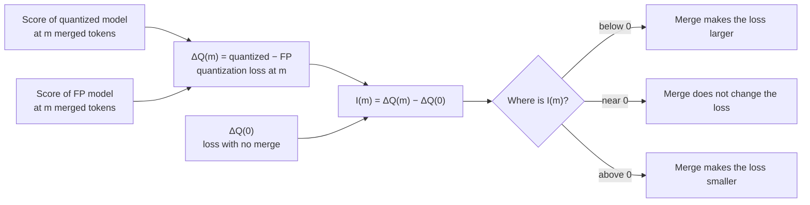
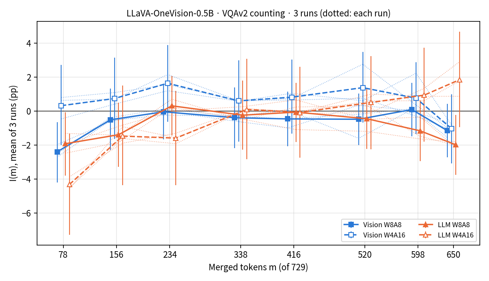
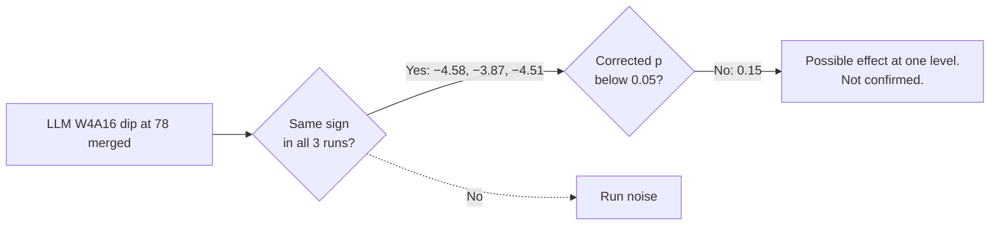

# Does Token Merge Make the Quantization Loss Larger?

This document continues the quantization section of `README.md`.
The first analysis tested only 338 and 650 merged tokens. This analysis tests all 8 merge levels, the trend, and repeat runs.

## Result

| Question | Answer |
|---|---|
| Is there a merge level where merge makes the quantization loss larger? | No level passes the multiple-test correction (0 of 128 tests). |
| Is the 0.5B LLM W4A16 dip at 78 merged tokens (10.7%) real? | It repeats in all 3 runs (−4.58, −3.87, −4.51 pp). The interval of the 3-run mean is below 0. But it does not pass the correction (corrected p = 0.15). Thus, it is a possible effect, not a confirmed effect. |
| Does the loss grow steadily as merge increases? | No. No series has a falling trend. The one significant trend (0.5B LLM W4A16, VQAv2 counting) goes up: the loss becomes smaller with more merge. |
| Does the loss change between merge levels at all? | No series shows a clear change after correction (0 of 16 overall tests). |

pp = percentage points.

## The quantity that we test



We use three tests. Each test answers one part of the question.

| Test | What it asks | Number of tests | Correction |
|---|---|---:|---|
| I(m) at each merge level | Is the loss at this level different from the loss with no merge? | 128 (16 series × 8 levels) | Holm, all 128 together |
| Trend | Does the loss grow or shrink steadily as merge increases? Slope per 10% of tokens merged. | 16 | Holm |
| Overall test (Hotelling T²) | Does I(m) differ from 0 at any level? This also compares the merge levels with each other. | 16 | Holm |

- A series is one model, one benchmark and one precision (2 × 2 × 4 = 16).
- Merge levels: 78, 156, 234, 338, 416, 520, 598 and 650 merged tokens (10.7% to 89.2% of 729).
- Interval: paired bootstrap on the same questions, 10,000 samples, 95%.
- p: normal approximation of the paired t statistic. The overall test uses the chi-square distribution with 8 degrees of freedom.
- Reading rule: a level counts as "larger loss" only when I(m) < 0 and the corrected p < 0.05.
- We wrote the protocol after we saw the first figures. We wrote it before we calculated these tests and before the new runs. The file is `experiments/2026-10-29_quant_interaction/protocol.json`.

## Part A: all merge levels, existing answers


- 8 of 128 tests have p < 0.05 before correction. With no real effect, approximately 6.4 tests have p < 0.05 by chance.
- 3 of the 8 are below 0. All 3 are 0.5B, VQAv2 counting, 78 merged tokens.
- 5 of the 8 are above 0 (opposite direction).
- 0 of 128 pass the Holm correction.

#### Tests with p < 0.05 before correction

| Model · benchmark · precision | Merged | I(m) (pp) | 95% interval | Corrected p |
|---|---:|---:|---|---:|
| 0.5B · VQAv2 counting · LLM W4A16 | 78 | −4.58 | −7.61 to −1.47 | 0.48 |
| 0.5B · VQAv2 counting · Vision W8A8 | 78 | −2.71 | −4.63 to −0.82 | 0.55 |
| 0.5B · VQAv2 counting · LLM W8A8 | 78 | −2.48 | −4.42 to −0.57 | 1.00 |
| 7B · VQAv2 counting · Vision W8A8 | 338 | +2.33 | +0.42 to +4.26 | 1.00 |
| 7B · VQAv2 counting · Vision W8A8 | 416 | +2.46 | +0.49 to +4.40 | 1.00 |
| 7B · VQAv2 counting · Vision W4A16 | 598 | +2.71 | +0.02 to +5.42 | 1.00 |
| 7B · VQAv2 counting · LLM W8A8 | 234 | +2.01 | +0.31 to +3.69 | 1.00 |
| 7B · GQA · Vision W8A8 | 598 | −1.35 | −2.65 to 0.00 | 1.00 |

#### Trend: slope of the quantization loss (pp for each 10% of tokens merged)

Negative slope: the loss grows with merge. Positive slope: the loss becomes smaller.

| Model · benchmark | Vision W8A8 | Vision W4A16 | LLM W8A8 | LLM W4A16 |
|---|---:|---:|---:|---:|
| 7B · VQAv2 counting | +0.01 | +0.11 | +0.03 | +0.15 |
| 7B · GQA | +0.01 | +0.04 | +0.01 | −0.11 |
| 0.5B · VQAv2 counting | +0.03 | +0.08 | −0.07 | **+0.46** ¹ |
| 0.5B · GQA | +0.05 | +0.05 | −0.06 | −0.06 |

¹ Interval +0.16 to +0.77, corrected p = 0.041. All other intervals include 0.

The positive slope comes from the scores below. The FP score falls as merge increases. The LLM W4A16 score stays near 45%. Thus, the gap becomes smaller.

| 0.5B · VQAv2 counting (%) | 0 | 78 | 156 | 234 | 338 | 416 | 520 | 598 | 650 |
|---|---:|---:|---:|---:|---:|---:|---:|---:|---:|
| FP | 62.13 | 56.28 | 52.99 | 52.17 | 51.55 | 51.17 | 51.26 | 50.55 | 49.63 |
| LLM W4A16 | 55.67 | 45.24 | 45.61 | 44.15 | 45.14 | 44.56 | 44.72 | 45.43 | 46.08 |
| ΔQ(m) | −6.46 | −11.04 | −7.38 | −8.02 | −6.41 | −6.61 | −6.54 | −5.12 | −3.55 |

#### Overall test

- 0 of 16 series pass the Holm correction.
- The smallest corrected p is 0.090 (0.5B, VQAv2 counting, LLM W4A16).
- All values are in `results/2026-10-29_quant_interaction/omnibus.csv`.

## Part B: repeat runs, 0.5B VQAv2 counting

ToSA can give different answers in different runs. Thus, one run can show a dip that does not repeat.
We did 2 more runs at all merge levels and all precisions. Then we used the mean of 3 runs for each question.



#### 78 merged tokens (10.7%)

| Precision | I(78), 3-run mean (pp) | 95% interval | Each run | Corrected p (32 tests) |
|---|---:|---|---|---:|
| LLM W4A16 | −4.32 | −7.28 to −1.32 | −4.58 / −3.87 / −4.51 | 0.15 |
| Vision W8A8 | −2.40 | −4.21 to −0.65 | −2.71 / −1.97 / −2.51 | 0.22 |
| LLM W8A8 | −1.92 | −3.79 to −0.06 | −2.48 / −1.31 / −1.97 | 1.00 |
| Vision W4A16 | +0.32 | −2.00 to +2.71 | −0.46 / +0.80 / +0.63 | 1.00 |



- The dip is not run noise. The 3 runs agree.
- The dip is at one level only. At 156 merged and more, all intervals include 0 (except LLM W8A8 at 650: −1.98, interval −3.75 to −0.23, corrected p = 0.76).
- The 3-run trend of LLM W4A16 is again positive: +0.41 pp per 10% (interval +0.14 to +0.69, corrected p = 0.012). The other 3 trends include 0.

#### Run-to-run change of I at 338 merged (3 runs, existing data)

| Model | Vision W8A8 | Vision W4A16 | LLM W8A8 | LLM W4A16 |
|---|---|---|---|---|
| 7B | +2.33 / +0.11 / −0.47 | +1.17 / −0.47 / −0.51 | +1.60 / +0.75 / −0.02 | −0.95 / −2.20 / −1.49 |
| 0.5B | −0.29 / −0.59 / −0.30 | +0.58 / +0.60 / +0.61 | −0.47 / −0.52 / +0.26 | +0.05 / +0.15 / +0.11 |

For 7B, one run can move I by up to 2.8 pp. Thus, a single-run value of 2 to 3 pp is not reliable for 7B.

## Answers to the review points

| Review point | Result of this analysis |
|---|---|
| 0.5B W4A16 counting at approximately 10% merge looks amplified. | It repeats in 3 runs and the interval is below 0. It does not pass the correction for the many levels tested. |
| The loss does not keep growing at 30%, 50%, 70% merge. | Confirmed. No series has a falling trend. The only significant trend goes up (smaller loss). |
| Other models and tasks show no steady growth. | Confirmed. 15 of 16 trends include 0. |
| Intervals that include 0 are not clear results. | We report them as "no clear difference". |
| The merge levels need a direct comparison. | The overall test compares all levels together. 0 of 16 series show a clear change. |

## Limits

- The quantization is simulated (fake quantization). It changes the values, not the speed or memory.
- No calibration data. Other quantization methods (for example, with calibration) can give other results.
- The repeat runs cover 0.5B VQAv2 counting only. The 7B model and GQA have 1 run at most levels (3 runs at 338 merged for VQAv2 counting).
- The 78-merged dip appears in 3 precisions at the same time. Each I(m) uses the same FP answers. Thus, the 3 dips are not independent.

## Files and reproduction

| Path | Contents |
|---|---|
| `experiments/2026-10-29_quant_interaction/protocol.json` | Frozen protocol |
| `results/2026-10-29_quant_interaction/raw/` | Answers of runs 1 and 2 (0.5B, VQAv2 counting, all precisions and levels), logs, environment |
| `results/2026-10-29_quant_interaction/interaction_all.csv` | Part A: I(m) at all levels, 128 tests |
| `results/2026-10-29_quant_interaction/trend.csv`, `omnibus.csv` | Part A: trend and overall test |
| `results/2026-10-29_quant_interaction/run_noise.csv` | I at 338 merged for each of 3 runs |
| `results/2026-10-29_quant_interaction/replicate_interaction.csv`, `replicate_trend.csv` | Part B: 3-run mean |
| `figures/quantization/interaction_all.png`, `interaction_replicate.png` | Figures of this document |

```bash
# New runs, in a PBS job (worker format model:precision:dataset:shard:num_shards:gpu):
scripts/launch_quant_replicate.sh JOB RUNTIME DATA 2026-10-29_quant_interaction OUTPUT 0.5B:FP:vqav2_count:0:2:0 ...
# Copy OUTPUT to results/2026-10-29_quant_interaction/raw, then:
python scripts/analyze_quant_interaction.py results/2026-10-28_tosa_quantization results/2026-10-29_quant_interaction figures/quantization
```
